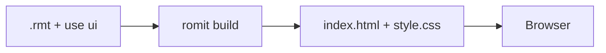

# Romit UI

Romit UI files start with `use ui`. There are two kinds:

- **Apps** (`app`, `state`, `screen`): reactive, SwiftUI-style interfaces with state, layout stacks, controls, navigation, tabs, sheets, and saved data. `romit build` writes one self-contained `index.html`. See **[Building apps](ui-apps.md)** and **[SwiftUI → Romit](reference/swiftui-map.md)**.
- **Pages** (`page`): static marketing-style pages compiled to HTML and CSS with no JavaScript, described below.

Browsers never read `.rmt` files.

```text
use ui

state
  name is ""

screen Home
  field "Your name" bind name
  text "Hello, {name}!" bold
    hidden if name is empty
```

## Static pages

- **Parts:** `page`, `header`, `brand`, `nav`, `hero`, `title`, `text`, `section`, `card`, `button`, `image`, `link`, `footer`, and page-level `theme`.
- **`romit build landing.rmt`** — writes `dist/index.html` and `dist/style.css` (or `--out DIR`).
- **`romit run page.rmt`** — local preview on `http://127.0.0.1:3847/`; rebuilds on each request (stdlib HTTP server only).
- **Default template** — built-in spacing, colors, typography, buttons, and responsive layout with zero config.
- **Overrides** — template file (optional), page `theme` block, and per-element modifiers. See [Templates and overrides](ui-templates.md).
- **Safety** — HTML escaping on all text; deterministic output; no JavaScript in the MVP.

## Example

[`examples/ui/landing.rmt`](https://github.com/romit07/romitlang/blob/main/examples/ui/landing.rmt):

```text
use ui

page Landing
  header
    brand "Acme"
    nav "Features" "Pricing" "Contact"
    button "Sign up"
  hero
    title "Ship faster"
    text "One line to say what it does."
    button "Get started"
  section "Features"
    card "Fast" "Compiles to plain HTML"
    card "Simple" "No setup"
  footer
    text "© Acme"
```

```bash
romit build examples/ui/landing.rmt
open examples/ui/dist/index.html
```

With page theme and a button override:

```text
use ui
use template default

page Landing
  theme
    color primary "#0a7"
  header
    button "Sign up" color blue
```

## How it reaches the browser



The compiler parses indentation-based UI syntax, validates parts (**U001** lists valid names), resolves theme tokens (**U006** lists valid tokens), and emits plain static assets. There is no client-side Romit runtime in the MVP.

## Planned

- Multi-page static sites and asset pipelines.
- Running **spec** rules inside apps.
- Native (iOS / Android) output for apps.

The Stage 4 roadmap in [Roadmap](reference/roadmap.md) covers the rest.

## Errors

| Code | Meaning |
|------|---------|
| U001 | Unknown UI part |
| U002 | Bad `use` line |
| U003 | Page structure |
| U006 | Unknown theme token |
| U007 | Template file problem |
| U008 | Output write error |
| U101–U117 | App errors; see [Error codes](reference/errors.md) |

See [Error codes](reference/errors.md) for parser codes shared with the core language.
