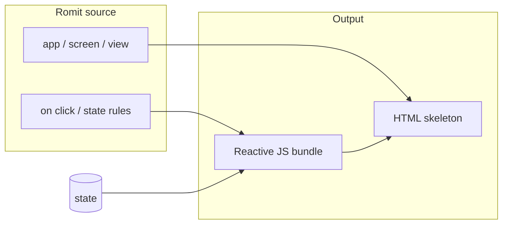

# UI framework

> **Planned — not implemented yet.**  
> Stage 1 of the `romit` compiler does **not** parse or compile UI specs. This page is a **design draft** only. Treat `examples/planned/*.rmt` as syntax sketches for a future Stage 4 toolchain.

## What we are aiming for

Romit’s UI layer is a **declarative, component-based** framework in the spirit of **SwiftUI** and **React**:

- You describe **what** the screen should look like and **what** happens on events.
- You do not manually wire DOM nodes or imperatively repaint the page.
- **Reactive `state`** drives the UI: when state changes, the visible screen updates automatically (same mental model as `@State` in SwiftUI or `useState` in React).

The compiler pipeline we plan (later) is:

1. Read the UI section of a `.rmt` file (views, layout, modifiers, events).
2. Emit **static HTML** for structure and accessibility.
3. Attach a small **reactive JavaScript** runtime that re-renders only what changed when Romit state updates.

None of that compilation exists in this repository today.

## Core ideas

### `view` components and parameters

A **view** is a named piece of UI. Views can take **parameters** (like SwiftUI’s struct properties or React props) using the same brace-free phrase style as the rest of Romit:

```text
view Badge label text small bool is false
  text label
    size 14
    muted small
```

Parameters are declared on the header line; the indented block is the view body. Composition works by nesting views inside layout containers.

### Reactive `state`

Screen-local or app-wide **state** is declared next to the screen (or in a dedicated `state` block). When a rule or handler runs `set count to count plus 1`, the UI layer should **re-bind** the `text` that reads `count`—no manual “refresh” call.

```text
screen Counter at /counter
  state
    count int is 0
```

This parallels:

| Framework | Reactive state |
|-----------|----------------|
| SwiftUI | `@State`, `@Observable` |
| React | `useState`, `useReducer` |
| Romit (planned) | `state` fields + automatic view updates |

### Layout containers

Nested layout is indentation-only, same as the declarative spec layer:

| Container | Role |
|-----------|------|
| `column` | Vertical stack (like `VStack` / a flex column) |
| `row` | Horizontal stack (like `HStack` / a flex row) |
| `list` | Scrollable list of items |

```text
column
  text "Title" bold
  row
    button "Cancel" outline
    button "OK"
```

### Elements

Basic building blocks:

| Element | Purpose |
|---------|---------|
| `text` | Labels and copy; can show a string or a state field |
| `button` | Tap target with a label |
| `input` | Text field bound to state (planned) |

Strings use `"..."`. State references use plain names: `text count` shows the current value of `count`.

### Modifiers

Modifiers are **trailing words** on a line (SwiftUI-style), not chained punctuation:

```text
text "Hello" size 16 bold
text count color accent padding 12
```

Common modifiers in the draft: `padding`, `color`, `size`, `bold`, `muted`, `outline`, `gap` on containers.

### Events

User gestures use phrase events—no parentheses:

```text
button "+"
  on click increment

on click increment
  set count to count plus 1
```

Navigation stays phrase-based too: `on click go to /settings` (see `examples/planned/landing-dark.rmt`).

## Example: counter (Romit draft)

Full planned example: [`examples/planned/counter_ui.rmt`](https://github.com/romit07/romitlang/blob/main/examples/planned/counter_ui.rmt).

```text
note PLANNED — UI counter demo. Not parsed by Stage 1 romit.

app CounterDemo
  screen Counter at /counter
    state
      count int is 0
    column
      padding 24
      gap 16
      align center
      text count
        size 48
        bold
      button "+"
        size 32
        on click increment
    on click increment
      set count to count plus 1
```

- **`state`**: `count` starts at `0`.
- **`text count`**: displays the live value.
- **`button "+"`**: `on click increment` raises the event.
- **Handler**: one line updates state; the UI runtime (future) redraws the text.

## Same counter in SwiftUI and React

These snippets are the **same app** in today’s frameworks—useful when you learn Romit’s planned syntax.

### SwiftUI

```swift
import SwiftUI

struct CounterView: View {
    @State private var count = 0

    var body: some View {
        VStack(spacing: 16) {
            Text("\(count)")
                .font(.largeTitle)
                .bold()
            Button("+") {
                count += 1
            }
        }
        .padding(24)
    }
}
```

SwiftUI keeps `count` in `@State` and rebuilds `body` when it changes. Romit’s draft uses an explicit `state` block and rules instead of a closure on the button.

### React

```jsx
import { useState } from "react";

export function Counter() {
  const [count, setCount] = useState(0);

  return (
    <div style={{ padding: 24, textAlign: "center" }}>
      <p style={{ fontSize: 48, fontWeight: "bold" }}>{count}</p>
      <button onClick={() => setCount(count + 1)}>+</button>
    </div>
  );
}
```

React stores `count` in component state and re-renders on `setCount`. Romit’s planned model moves the increment into a declarative `on click` handler that `set`s spec state, closer to the **event / rule** style you already use in beginner `.rmt` files.

## How compilation might work (future)

This is **not built**; it explains the target so tooling can align later.



- **HTML**: semantic tags from `column`, `row`, `text`, `button`, `input`; modifiers become classes or inline data attributes.
- **JS**: a tiny runtime subscribes to state keys (`count`, etc.) and updates text nodes and attributes when handlers fire.
- **Shared rules**: the same `romit test` / interpreter ideas from Stage 1 can eventually drive both server logic and UI events.

## Where to go next

- Landing page draft: `examples/planned/landing-dark.rmt`
- Shorter planned overview: [Planned UI syntax](examples/planned.md)
- Roadmap: [Roadmap](reference/roadmap.md) (Stage 4)

When the UI compiler lands, this page will move out of “planned” and gain a tutorial that runs `romit build` (or similar) on `counter_ui.rmt`. Until then, **`romit check` will not accept UI-only files** as valid Stage 1 programs.
